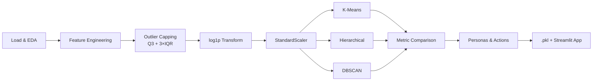
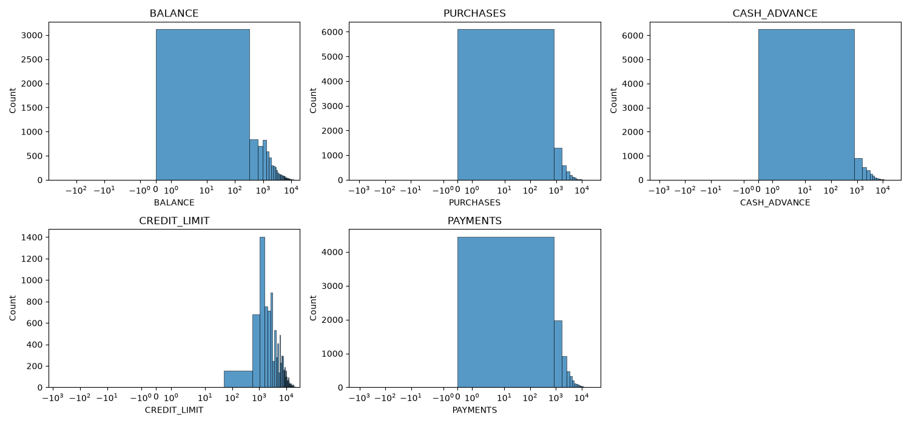
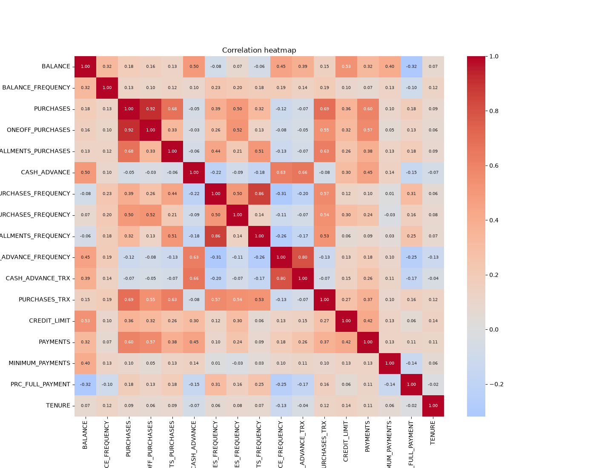
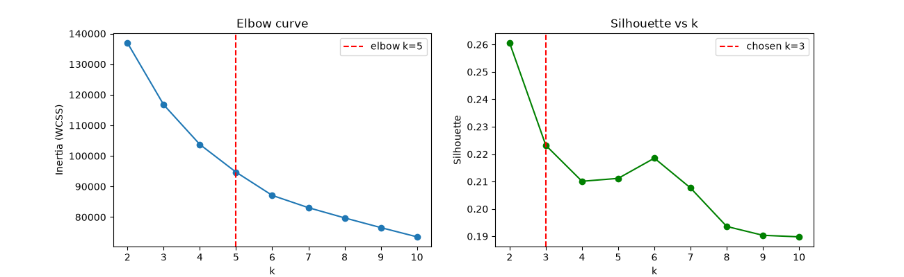
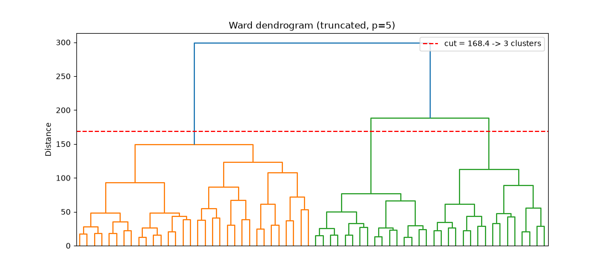
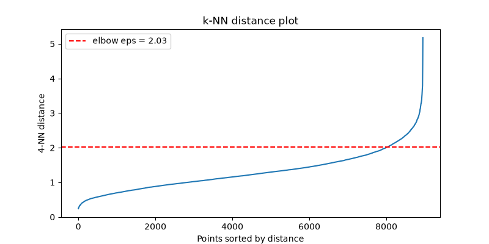

<div align="center">


<a href="https://git.io/typing-svg"></a>

<br/>

[](https://www.python.org/)
[](https://scikit-learn.org/)
[](https://streamlit.io/)
[](notebook/credit_card_customer_segmention.ipynb)
[](https://www.kaggle.com/datasets/arjunbhasin2013/ccdata)
[](#-demo-video)

</div>

---

## 📑 Table of Contents

- [📌 Project Overview](#-project-overview)
- [🎯 Objectives](#-objectives)
- [📂 Repository Structure](#-repository-structure)
- [📊 Dataset](#-dataset)
- [🛠️ Tech Stack](#️-tech-stack)
- [🔄 Methodology](#-methodology)
- [📈 Results & Visualisations](#-results--visualisations)
- [👥 Customer Personas](#-customer-personas)
- [🚀 Streamlit App](#-streamlit-app)
- [🌐 Live Streamlit App Link](#-live-streamlit-app-link)
- [🎬 Demo Video](#-demo-video)
- [⚙️ Setup & Installation](#️-setup--installation)
- [📄 Report](#-report)
- [🔮 Future Work](#-future-work)
- [👤 Author](#-author)

---

## 📌 Project Overview

A large Indian private bank (think HDFC / ICICI) wants to move away from one-size-fits-all card upgrades, reward programmes and limit revisions. This project groups **8,950 active credit-card holders** into meaningful **behavioural segments** so Relationship Managers can offer the right product to the right customer, reducing attrition and increasing wallet share.

Behavioural features are engineered from raw usage data, then **three unsupervised algorithms** are tuned, evaluated with internal metrics and compared: **K-Means**, **Agglomerative Hierarchical Clustering** and **DBSCAN**. The best model is saved and served through a **Streamlit** app.

> 🏫 *Red & White Skill Education — Practical Exam — Unsupervised Learning (Set C)*

---

## 🎯 Objectives

- Understand how **clustering** differs from classification.
- Engineer behavioural features (monthly averages, limit usage, payment-to-minimum ratio).
- Tune **K-Means** (Elbow + Silhouette), **Hierarchical** (Dendrogram) and **DBSCAN** (k-NN distance plot + grid search).
- Evaluate with **Silhouette, Davies-Bouldin and Calinski-Harabasz** indices.
- Translate clusters into **actionable credit-card personas** for the business.
- Deploy a scoring pipeline (`.pkl` files + Streamlit app).

---

## 📂 Repository Structure

```
creditcard-segmentation-unsupervised-learning/
│
├── 📁 dataset/
│   └── CC GENERAL.csv                       # Kaggle credit card dataset
├── 📁 images/                               # Plots exported from the notebook (01–08)
├── 📁 models/
│   ├── cc_scaler.pkl                        # Fitted StandardScaler
│   └── cc_segmentation_model.pkl            # Best model + preprocessing metadata + personas
├── 📁 notebook/
│   └── credit_card_customer_segmention.ipynb  # Fully executed notebook
├── 📁 report/
│   └── summary_report.md                    # ~1-page business summary
├── 📄 app.py                                # Streamlit app
├── 📄 requirements.txt                      # Python dependencies
└── 📄 README.md
```

---

## 📊 Dataset

| Item | Details |
|---|---|
| **Name** | Credit Card Dataset for Clustering |
| **Source** | [Kaggle – arjunbhasin2013/ccdata](https://www.kaggle.com/datasets/arjunbhasin2013/ccdata) |
| **Rows** | 8,950 cardholders |
| **Columns** | 18 (17 behavioural features + `CUST_ID`) |
| **Key features** | `BALANCE`, `PURCHASES`, `CASH_ADVANCE`, `CREDIT_LIMIT`, `PAYMENTS`, `MINIMUM_PAYMENTS`, `PRC_FULL_PAYMENT`, `TENURE` |
| **Cleaning** | `CUST_ID` dropped; 1 missing `CREDIT_LIMIT` and 313 missing `MINIMUM_PAYMENTS` imputed with the median |

**Quick insights:** 22.8% of customers never made a purchase, and ~26% of customers generate 80% of total purchase volume.

---

## 🛠️ Tech Stack


---

## 🔄 Methodology



| Step | What was done |
|---|---|
| **1. EDA** | Missing values, duplicates, histograms (log-scaled), correlation heatmap, utilisation ratio, Pareto analysis |
| **2. Features** | `Monthly_Avg_Purchase`, `Monthly_Avg_Cash_Advance`, `Limit_Usage`, `Payment_to_Minpayment_Ratio` |
| **3. Preprocessing** | Winsorise at Q3 + 3×IQR → `log1p` on skewed money columns → `StandardScaler` |
| **4. K-Means** | Elbow + Silhouette for k = 2–10 → **k = 3** |
| **5. Hierarchical** | Ward dendrogram, cut at 3 clusters; ward vs complete vs average compared |
| **6. DBSCAN** | k-NN distance elbow (ε ≈ 2.03) + grid over ε × min_samples → ε = 2.03, min_samples = 10 |
| **7. Evaluation** | Silhouette ↑, Davies-Bouldin ↓, Calinski-Harabasz ↑, noise %, seed-stability check |
| **8. Deployment** | `cc_scaler.pkl`, `cc_segmentation_model.pkl`, `predict_segment()`, Streamlit app |

---

## 📈 Results & Visualisations

### Algorithm Comparison

| Algorithm | Settings | Clusters | Silhouette ↑ | Davies-Bouldin ↓ | Calinski-Harabasz ↑ | Noise % |
|---|---|---|---|---|---|---|
| 🏆 **K-Means** | k = 3, k-means++ | 3 | **0.223** | 1.679 | **2,729** | 0.0 |
| Agglomerative | ward, 3 clusters | 3 | 0.198 | 1.728 | 2,213 | 0.0 |
| DBSCAN | ε = 2.03, min_samples = 10 | 3 | 0.122 | 0.951 | 87 | 8.3 |

**K-Means** ranks first overall and is **stable across seeds** (silhouette std ≈ 0.000), so it is the model deployed. DBSCAN's 8.3% noise points are useful as a flag for unusual accounts needing manual review. K-Means vs Hierarchical agreement (Adjusted Rand Index) = 0.33.

### 🔍 Exploratory Analysis

<table>
<tr>
<td align="center"><b>Feature Distributions</b><br/></td>
<td align="center"><b>Correlation Heatmap</b><br/></td>
</tr>
</table>

### 🔵 K-Means

<p align="center"></p>
<p align="center"></p>

### 🌳 Hierarchical Clustering

<p align="center"></p>
<p align="center"></p>

### 🔴 DBSCAN

<p align="center"></p>
<p align="center"></p>

---

## 👥 Customer Personas

| Segment | Share | Behaviour | Recommended Action |
|---|---|---|---|
| 💎 **Premium Spenders** | 36% | High purchases (≈2.2× average), above-average credit limit | Upgrade to premium card with travel & lifestyle rewards and a higher limit |
| 💸 **Cash-Advance Reliant** | 32% | Heavy cash advances (≈2.2×), almost no purchases, rarely pay in full | Offer low-rate personal loan / cash-advance-to-EMI conversion; monitor credit risk |
| 🛒 **Low-Balance Full Payers** | 32% | Near-zero balance, pay in full, light spending | Drive usage with cashback / EMI-on-card offers and merchant tie-ups |

---

## 🚀 Streamlit App

An interactive app that scores a new cardholder using the saved scaler and model and returns the **segment**, the **recommended business action** and the **segment profile table**.

**Features**
- Enter balance, purchases, cash advance, credit limit, payments, frequencies, transaction counts and tenure
- Same preprocessing as training (feature engineering → outlier caps → log1p → scaling)
- Instant persona + recommended action
- Highlighted segment profile comparison table

**Run locally**

```bash
pip install -r requirements.txt
streamlit run app.py
```

<!-- Replace with a screenshot of the running app: save it as images/09.streamlit_app.png -->
<!-- <p align="center"></p> -->

---

## 🌐 Live Streamlit App Link

<div align="center">

[](PASTE_YOUR_STREAMLIT_APP_LINK_HERE)

[](https://creditcardcustomersedmentation.streamlit.app/)

</div>

---

## 🎬 Demo Video

[](https://drive.google.com/file/d/1VxfBUSPnYMPQsytYfJFepr_w3dJSCWjS/view?usp=sharing)

---

## ⚙️ Setup & Installation

```bash
# 1. Clone the repository
git clone https://github.com/RENSEE-GAJIPARA/creditcard-segmentation-unsupervised-learning.git
cd creditcard-segmentation-unsupervised-learning

# 2. (Optional) create a virtual environment
python -m venv venv
venv\Scripts\activate          # Windows
# source venv/bin/activate     # macOS / Linux

# 3. Install dependencies
pip install -r requirements.txt

# 4. Run the notebook
jupyter notebook notebook/credit_card_customer_segmention.ipynb

# 5. Launch the app
streamlit run app.py
```

---

## 📄 Report

The ~1-page business summary (problem, features, algorithm comparison, segments, actions, next steps) is in [`report/summary_report.md`](report/summary_report.md).

---

## 🔮 Future Work

- Add transaction-level and time-series features (spend trends, merchant categories)
- Use delinquency / churn labels for semi-supervised refinement and validation
- Real-time scoring API (FastAPI) behind the saved scaler and model
- Re-cluster periodically to detect segment drift

---

## 👤 Author

<div align="center">

**Rensee Gajipara**
B.Tech — Artificial Intelligence & Data Science, SCET, Surat

[](https://github.com/RENSEE-GAJIPARA)
[](https://linkedin.com/in/rensee-gajipara)
[](mailto:renseegajipara@gmail.com)


⭐ *If you found this useful, consider starring the repository.*

</div>

</div>
